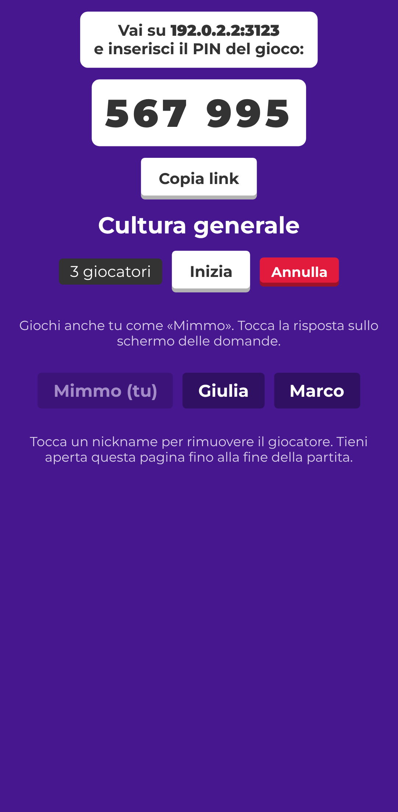
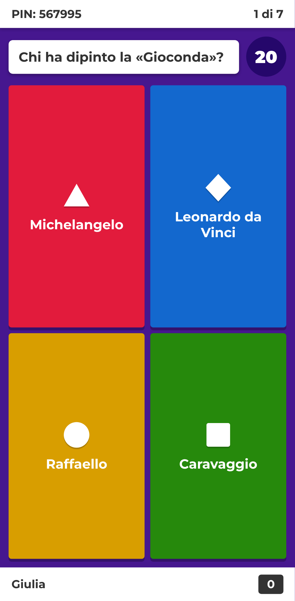
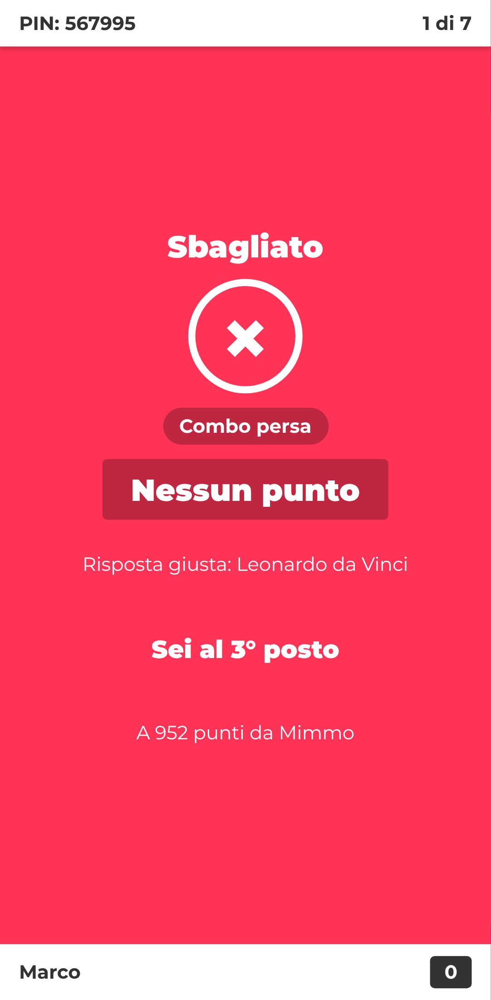
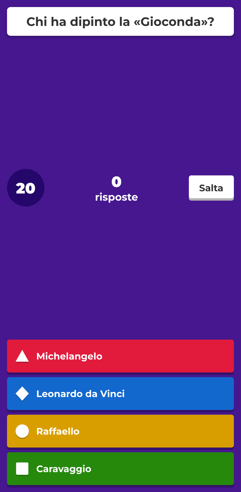
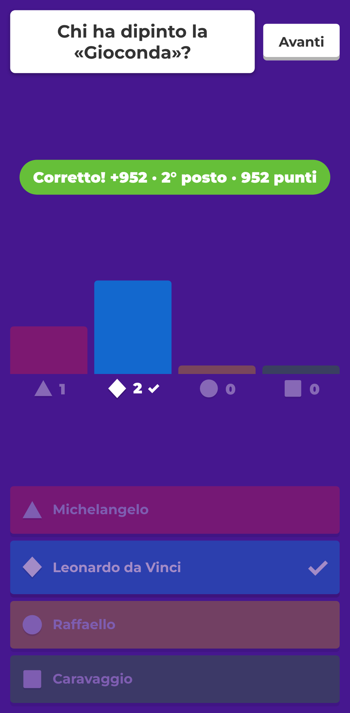
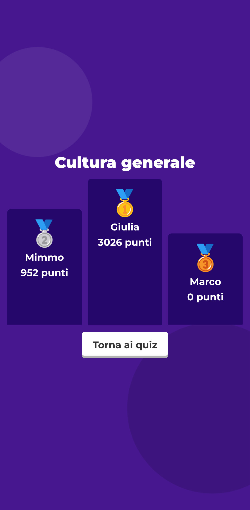

# Quizzone!

Gioco a quiz multigiocatore in tempo reale, in italiano, ispirato al flusso di gioco di [kahoot.it](https://kahoot.it).
**Si gioca interamente da telefono**: chi organizza crea la partita dal proprio smartphone, gli altri
entrano con il PIN (o con il link condiviso) e rispondono toccando le forme colorate. Domanda e risposte
compaiono su ogni telefono, quindi non serve uno schermo grande.

**Gioca subito: <https://quizzone-it.netlify.app>** (organizzatore: <https://quizzone-it.netlify.app/host>)

| Organizzatore | Giocatore | Giocatore |
| --- | --- | --- |
|  |  |  |
|  |  |  |

## Come si gioca

1. **Organizzatore:** apre il sito, tocca **Organizza una partita**, sceglie un quiz e tocca **Ospita**.
   Con **Condividi link** manda l'invito (WhatsApp, Telegram…); con **Gioca anche tu** partecipa a sua volta.
2. **Giocatori:** aprono il link ricevuto, oppure il sito e inseriscono il PIN, poi scelgono un nickname.
3. L'organizzatore tocca **Inizia**: per ogni domanda tutti vedono testo, risposte e tempo sul proprio telefono.

Consigli: l'organizzatore deve tenere aperta la pagina fino alla fine (dopo aver condiviso il link,
torna subito su Quizzone!). Se un giocatore perde la connessione o ricarica la pagina, rientra da solo
nella partita con il suo punteggio.

## Come funziona online

Il sito è **statico** (cartella `public/`, pubblicata su Netlify con `netlify.toml`). La partita gira nel
browser dell'organizzatore; i telefoni non si collegano tra loro direttamente, ma si scambiano i messaggi
attraverso **5 relay pubblici [Nostr](https://nostr.com)** (WebSocket sicuri sulla porta 443, la stessa dei
siti web). Per questo **funziona anche se ognuno usa una connessione diversa**: 4G/5G, Wi-Fi di casa,
hotspot, reti di operatori diversi.

- Ogni messaggio è un evento Nostr *effimero* (inoltrato, non salvato) firmato con una chiave creata dal
  telefono: la firma identifica il giocatore, quindi nessuno può rispondere al posto di un altro.
- Lo stesso messaggio parte su tutti i relay e chi lo riceve scarta i doppioni: se uno o più relay non
  funzionano, la partita va avanti con gli altri.
- Risposte e richieste di ingresso vengono ripetute finché l'host non conferma; ogni 4 secondi l'host invia
  un segnale con la fase della partita e chi è rimasto indietro (rete persa, app in sottofondo, pagina
  ricaricata) si rimette in pari da solo.
- Non ci sono account né database: i quiz creati restano nel browser di chi li ha creati.

Libreria inclusa: [nostr-tools](https://github.com/nbd-wtf/nostr-tools) 2.25.2 (pubblico dominio) in
`public/vendor/`.

## Sviluppo locale

```bash
npm install
npm start          # http://localhost:3000  (organizzatore: /host)
npm test
```

Per provare dal telefono apri `http://<ip-del-computer>:3000` (serve comunque internet per i relay).

## Funzionalità

- PIN di 6 cifre, link d'invito condivisibile, sala d'attesa (tocca un nome per rimuovere il giocatore).
- L'organizzatore può giocare anche lui; ci si può unire anche a partita iniziata.
- Domande a scelta multipla (2–4 risposte) e vero/falso, con tempo limite configurabile.
- Schermate del giocatore: PIN → nickname → «Eccoti!» → «Preparati!» → domanda → «Risposta inviata»
  → «Corretto / Sbagliato / Tempo scaduto» (con la risposta giusta) → posizione finale.
- Schermate dell'organizzatore: sala d'attesa → domanda con timer e contatore (pulsante «Salta»)
  → grafico delle risposte → classifica (top 5) → podio.
- Riconnessione automatica dei giocatori; lo schermo resta acceso durante la partita (dove supportato).
- Punteggio: fino a 1000 punti per risposta corretta (metà dipende dalla velocità) più un bonus combo
  di 100 punti per ogni risposta corretta consecutiva, fino a 500.
- Tre quiz di esempio (Geografia d'Italia, Cultura generale, Cucina italiana) e un editor per crearne di nuovi.

## Struttura

```
public/index.html   App del giocatore             public/js/player.js
public/host.html    App dell'organizzatore + editor  public/js/host.js
public/js/game.js   Logica di gioco (giocatori, risposte, punteggi, classifica)
public/js/net.js    Rete di gioco via relay Nostr e blocco dello spegnimento schermo
public/js/quizzes.js  Quiz di esempio
netlify.toml        Pubblicazione statica della cartella public/
server.js           Server statico solo per lo sviluppo locale
test/               Test della logica di gioco
```

La risposta corretta non viene inviata ai giocatori prima della chiusura della domanda.

## Come è stato ricostruito (analisi con REA)

Il flusso è stato ricavato con la skill [REA](https://github.com/morluto/rea) (`rea-agents` 6.4.0, CLI
`analyze-javascript-application`) sui bundle JavaScript pubblici del controller di kahoot.it
(`assets-cdn.kahoot.it/controller/v2/assets/`), analizzati staticamente senza eseguirli.
Evidence: `ev_2976fa3cc771f0379a076df171a0793ab73ad211dd4c5fdc7c495100ec1cff7c`
(5 file JS analizzati, ~1,9 M nodi AST, 0 errori di parsing).

**Osservato nei bundle**

- Rotte del giocatore: `/join`, `/instructions`, `/start`, `/getready`, `/gameblock`, `/answer/sent`,
  `/answer/result`, `/ranking`, `/gameover` (più varianti: `/join/team`, `/contentblock`, `/feedback`, …).
- Trasporto in tempo reale CometD (`/cometd`) e prenotazione della sessione via
  `/reserve/session`; il PIN può arrivare dal percorso (`/:pathPin`).
- Chiavi di rete/archiviazione `pin`, `nickname`, `sessionId`, `music`, `sound`.
- Palette delle risposte nel CSS: `#e21b3c`, `#1368ce`, `#d89e00`, `#26890c` su viola `#46178f`.
- Tipi di blocco: `quiz`, `multiple_select_quiz`, `true_false`, `open_ended`, `survey`, `jumble`,
  `slider`, `word_cloud`, `drop_pin`, `brainstorming`, `content`.
- Il bundle di localizzazione italiana (`locales/controller/it.json`) conferma toni ed etichette
  («Eccoti!», «Preparati!», «Corretto», «Sbagliato», «Tempo scaduto», «Combo», «Sei sul podio!»).

**Scelte di progettazione (non osservate)**

- Relay pubblici Nostr al posto di CometD: nessun server di gioco da gestire, nessun account.
- Domanda e risposte mostrate anche sui telefoni dei giocatori, così si gioca senza schermo condiviso.
- Formula del punteggio e del bonus combo: modello semplificato, non letto dal codice originale.
- Implementati solo i tipi `quiz` e vero/falso; gli altri tipi osservati restano fuori.
- Nome, logo e testi sono originali: il progetto non usa marchi né risorse di Kahoot!.

**Limiti**: l'analisi è statica; il comportamento lato server di Kahoot (punteggi, temporizzazioni)
non è stato osservato e qui è reinterpretato.
