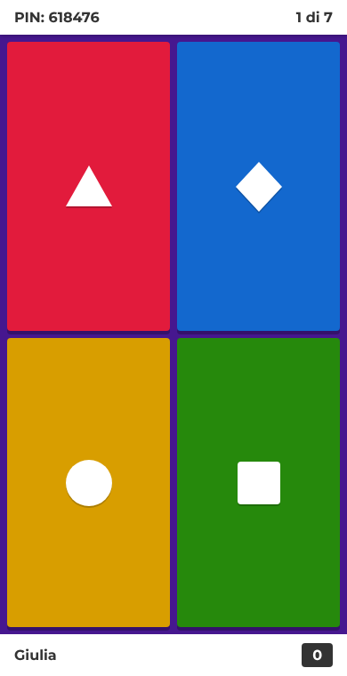
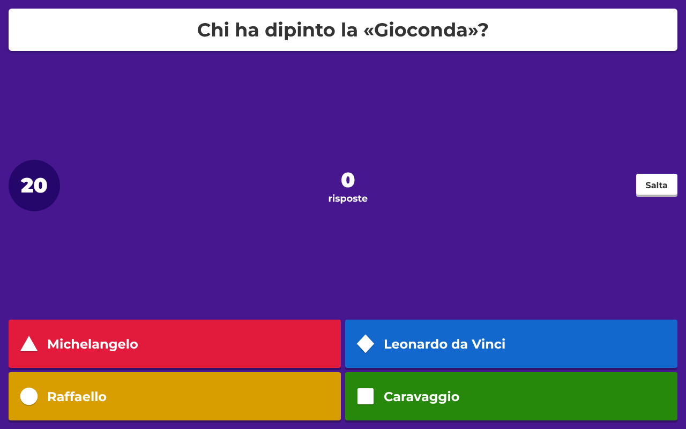
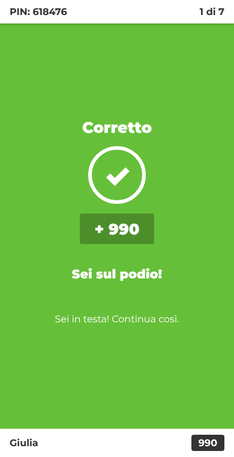
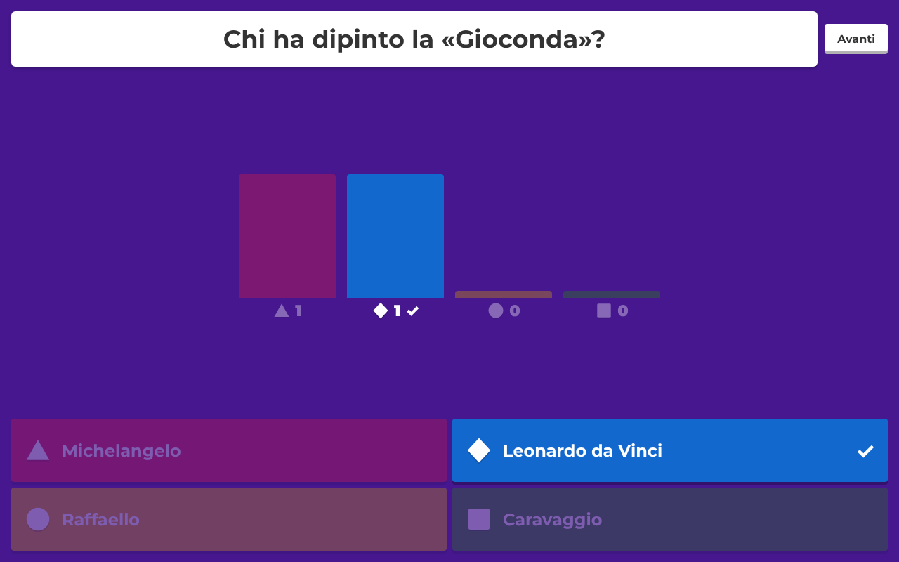

# Quizzone!

Gioco a quiz multigiocatore in tempo reale, in italiano, ispirato al flusso di gioco di [kahoot.it](https://kahoot.it).
Un organizzatore proietta le domande su uno schermo grande; i partecipanti entrano dal telefono con un PIN
e rispondono toccando forme colorate. Le risposte corrette e veloci valgono più punti.

| Giocatore (telefono) | Host (schermo grande) |
| --- | --- |
|  |  |
|  |  |

## Avvio

```bash
npm install
npm start          # http://localhost:3000
```

- **Host:** apri `http://localhost:3000/host`, scegli un quiz e clicca **Ospita**.
- **Giocatori:** aprono `http://<indirizzo-del-server>:3000`, inseriscono il PIN e un nickname.
  Si può anche condividere il link diretto `/?pin=123456`.

Porta personalizzabile con `PORT=8080 npm start`. Test: `npm test`.

## Funzionalità

- PIN di 6 cifre, sala d'attesa con elenco dei giocatori (clic su un nome per rimuoverlo).
- Domande a scelta multipla (2–4 risposte) e vero/falso, con tempo limite configurabile.
- Schermate del giocatore: PIN → nickname → «Eccoti!» → «Preparati!» → risposta → «Risposta inviata»
  → «Corretto / Sbagliato / Tempo scaduto» → posizione finale.
- Schermate dell'host: sala d'attesa → domanda con timer e contatore risposte (pulsante «Salta»)
  → grafico delle risposte → classifica (top 5) → podio.
- Punteggio: fino a 1000 punti per risposta corretta (metà dipende dalla velocità) più un bonus combo
  di 100 punti per ogni risposta corretta consecutiva, fino a 500.
- Tre quiz di esempio (Geografia d'Italia, Cultura generale, Cucina italiana) e un editor per creare
  i propri quiz, salvati nel browser dell'host.

## Struttura

```
server.js          Express + Socket.IO: stanze per PIN, timer e inoltro degli eventi
src/game.js        Logica di gioco pura (giocatori, risposte, punteggi, classifica)
src/quizzes.js     Quiz di esempio
public/index.html  App del giocatore        public/js/player.js
public/host.html   App dell'host + editor   public/js/host.js
test/              Test di logica e una partita completa via socket
```

La risposta corretta non viene mai inviata ai client prima della chiusura della domanda.

## Come è stato ricostruito (analisi con REA)

Il flusso è stato ricavato con la skill [REA](https://github.com/morluto/rea) (`rea-agents` 6.4.0, CLI
`analyze-javascript-application`) sui bundle JavaScript pubblici del controller di kahoot.it
(`assets-cdn.kahoot.it/controller/v2/assets/`), analizzati staticamente senza eseguirli.
Evidence: `ev_2976fa3cc771f0379a076df171a0793ab73ad211dd4c5fdc7c495100ec1cff7c`
(5 file JS analizzati, ~1,9 M nodi AST, 0 errori di parsing).

**Osservato nei bundle**

- Rotte del giocatore: `/join`, `/instructions`, `/start`, `/getready`, `/gameblock`, `/answer/sent`,
  `/answer/result`, `/ranking`, `/gameover` (più varianti: `/join/team`, `/contentblock`, `/feedback`, …).
- Trasporto in tempo reale CometD (`/cometd`) e prenotazione della sessione via
  `/reserve/session`; il PIN può arrivare dal percorso (`/:pathPin`).
- Chiavi di rete/archiviazione `pin`, `nickname`, `sessionId`, `music`, `sound`.
- Palette delle risposte nel CSS: `#e21b3c`, `#1368ce`, `#d89e00`, `#26890c` su viola `#46178f`.
- Tipi di blocco: `quiz`, `multiple_select_quiz`, `true_false`, `open_ended`, `survey`, `jumble`,
  `slider`, `word_cloud`, `drop_pin`, `brainstorming`, `content`.
- Il bundle di localizzazione italiana (`locales/controller/it.json`) conferma toni ed etichette
  («Eccoti!», «Preparati!», «Corretto», «Sbagliato», «Tempo scaduto», «Combo», «Sei sul podio!»).

**Scelte di progettazione (non osservate)**

- Socket.IO al posto di CometD; nessun account, nessuna persistenza lato server.
- Formula del punteggio e del bonus combo: modello semplificato, non letto dal codice originale.
- Implementati solo i tipi `quiz` e vero/falso; gli altri tipi osservati restano fuori.
- Nome, logo e testi sono originali: il progetto non usa marchi né risorse di Kahoot!.

**Limiti**: l'analisi è statica; il comportamento lato server di Kahoot (punteggi, temporizzazioni)
non è stato osservato e qui è reinterpretato.
