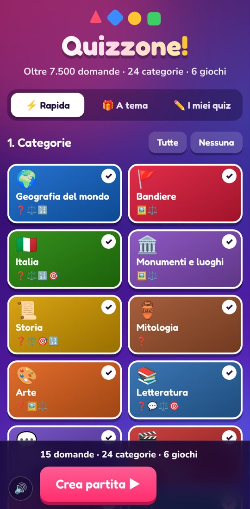
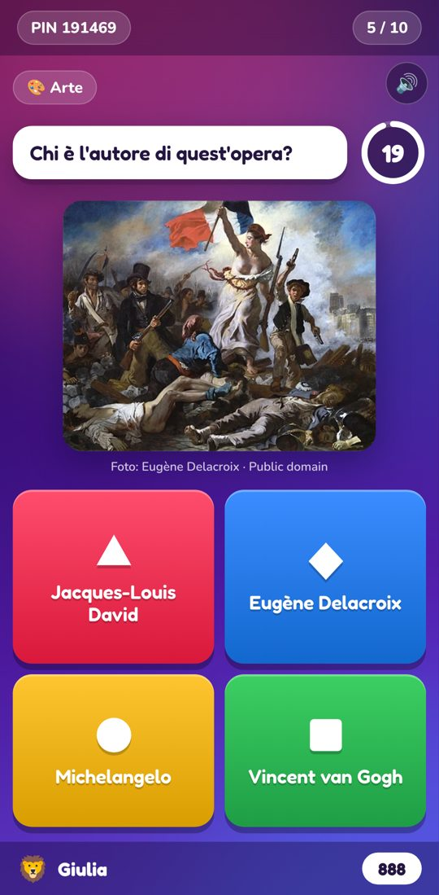
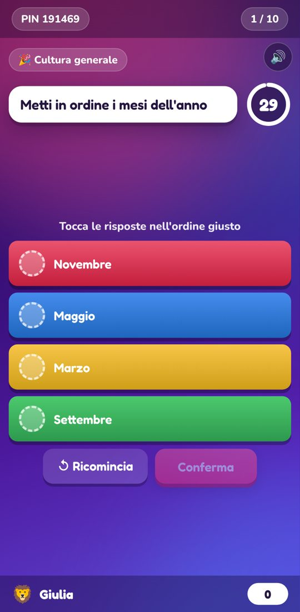
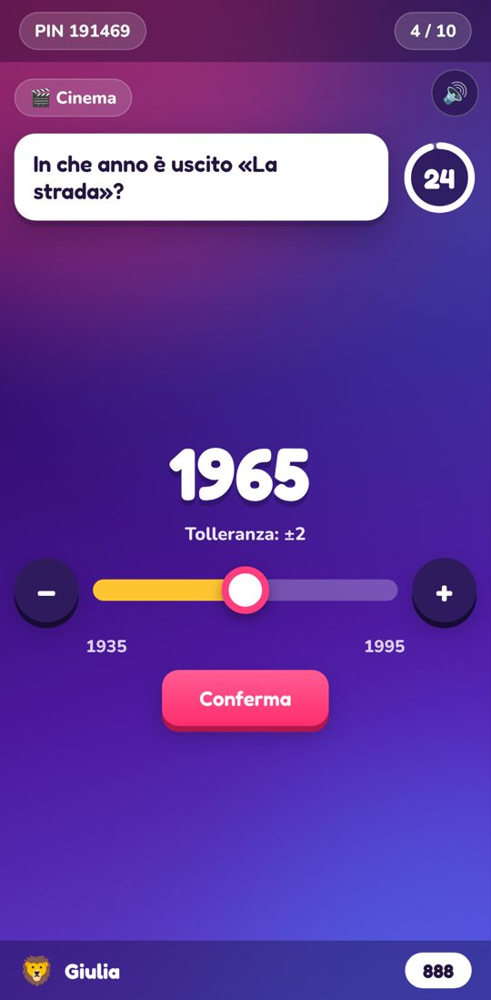
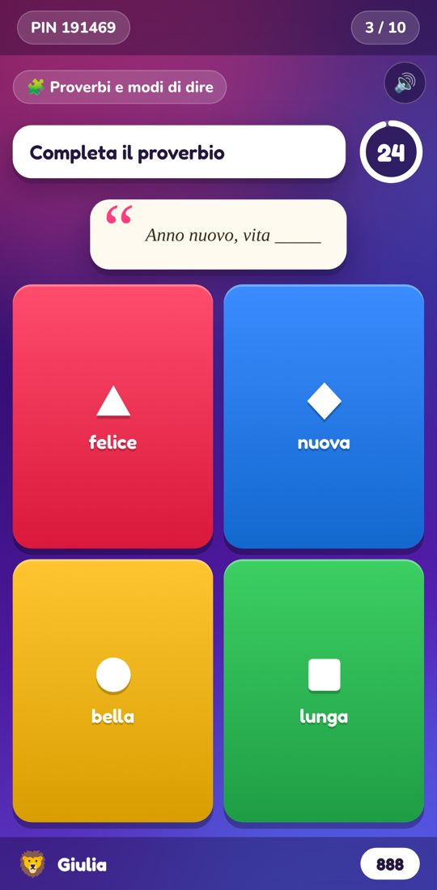
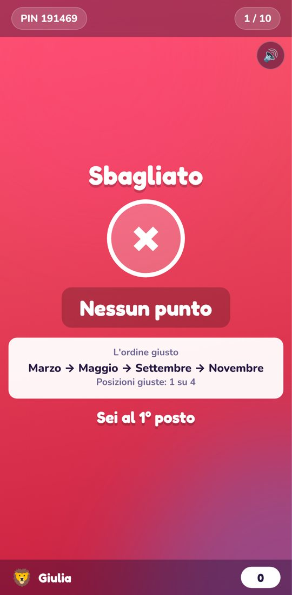
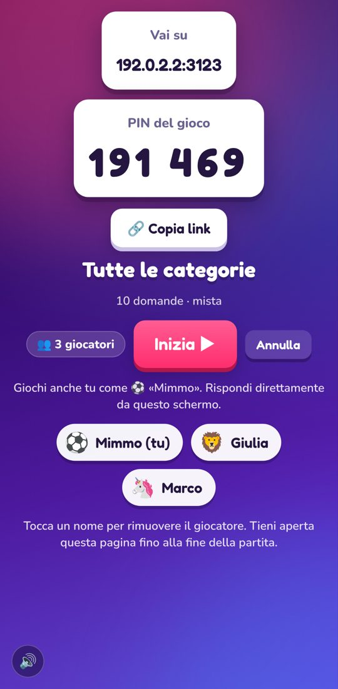
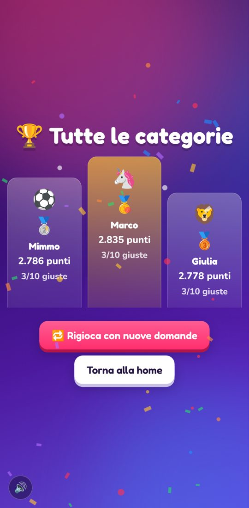

# Quizzone!

Gioco a quiz multigiocatore in tempo reale, in italiano, ispirato al flusso di gioco di [kahoot.it](https://kahoot.it).
**Si gioca interamente da telefono**, anche con connessioni diverse: chi organizza crea la partita dal proprio
smartphone, gli altri entrano con il PIN o con il link condiviso.

**Gioca subito: <https://quizzone-it.netlify.app>** (organizzatore: <https://quizzone-it.netlify.app/host>)

| Home | Indovina dall'immagine | Metti in ordine | Indovina il numero |
| --- | --- | --- | --- |
|  |  |  |  |
| **Chi l'ha detto?** | **Risultato** | **Sala d'attesa** | **Podio** |
|  |  |  |  |

## Cosa c'è dentro

- **Oltre 9.500 domande diverse** (più infinite domande di matematica e migliaia di combinazioni per intrusi e duelli) in **24 categorie**:
  Geografia del mondo, Bandiere, Italia, Monumenti e luoghi, Storia, Mitologia, Arte, Letteratura, Citazioni,
  Cinema, Musica, Scienza, Elementi chimici, Spazio, Corpo umano, Animali, Sport, Cucina, Lingua italiana,
  Inglese, Proverbi e modi di dire, Matematica, Invenzioni e tecnologia, Cultura generale.
- **9 giochi diversi**, mescolabili nella stessa partita:
  - ❓ **Quiz**: quattro risposte, una giusta.
  - ⚖️ **Vero o falso**, con la spiegazione quando è falso.
  - 🖼️ **Indovina dall'immagine**: 195 bandiere, oltre 180 foto di monumenti, opere d'arte e animali, film e
    proverbi raccontati con le emoji.
  - 💬 **Chi l'ha detto?**: citazioni celebri, versi, battute di film, incipit, «completa la citazione» e i proverbi.
  - 🔢 **Metti in ordine**: eventi storici, film, classifiche (fiumi, montagne, Paesi…), sequenze. Punti solo
    se l'ordine è tutto giusto.
  - 🎯 **Indovina il numero**: anni, misure e stime con un cursore; punti pieni se esatto, che calano entro la
    tolleranza.
  - ⌨️ **Scrivi la risposta**: si digita la risposta sul telefono; maiuscole, accenti, articoli e un piccolo
    errore di battitura vengono perdonati. Sullo schermo dell'host compaiono le risposte date.
  - 🕵️ **Trova l'intruso**: tre elementi hanno qualcosa in comune, uno no.
  - ⚔️ **Testa a testa**: due opzioni, chi vince il confronto (più antico, più lungo, più alto…).
- **Partita rapida**: scegli categorie, giochi, numero di domande (5–50), difficoltà (facile, media, difficile,
  mista o **progressiva**, da facile a difficile) e tempo (veloce, normale, rilassato). Le domande non si
  ripetono nella stessa partita.
- **Punti doppi a sorpresa** ⚡: alcune domande, e sempre l'ultima, valgono il doppio.
- **6 temi di colore** (Classico, Galassia, Oceano, Tramonto, Foresta, Ora d'oro): li sceglie l'host e cambiano
  anche sui telefoni dei giocatori.
- 🎯 **Allenati da solo** (`/solo`): una partita sul proprio telefono senza PIN né organizzatore, con i record
  personali.
- **Si installa come un'app**: «Aggiungi alla schermata Home» su iPhone e Android, con icona e schermo intero.
- **Partite a tema** già pronte (Il giro del mondo, Viaggio in Italia, Serata al cinema, Ritorno a scuola…).
- **Editor** per creare i propri quiz con tutti i tipi di domanda (anche con immagine o emoji).
- Avatar per i giocatori, combo di risposte giuste, classifica animata (posizioni guadagnate e punti che salgono),
  podio con coriandoli, suoni (disattivabili),
  vibrazione sul telefono e **«Rigioca con nuove domande»** con gli stessi giocatori e lo stesso PIN.

## Come si gioca

1. **Organizzatore:** apre il sito, tocca **Organizza una partita**, sceglie categorie e giochi (o una partita a
   tema) e tocca **Crea partita**. Con **Condividi link** manda l'invito; con **Gioca anche tu** partecipa a sua volta.
2. **Giocatori:** aprono il link, oppure il sito e inseriscono il PIN, poi scelgono nickname e avatar.
3. L'organizzatore tocca **Inizia**: per ogni domanda tutti vedono testo, immagini e risposte sul proprio telefono.

Consigli: l'organizzatore deve tenere aperta la pagina fino alla fine (dopo aver condiviso il link,
torna subito su Quizzone!). Se un giocatore perde la connessione o ricarica la pagina, rientra da solo
nella partita con il suo punteggio.

## Come funziona online

Il sito è **statico** (cartella `public/`, pubblicata su Netlify con `netlify.toml`). La partita gira nel
browser dell'organizzatore; i telefoni non si collegano tra loro direttamente, ma si scambiano i messaggi
attraverso **5 relay pubblici [Nostr](https://nostr.com)** (WebSocket sicuri sulla porta 443, la stessa dei
siti web). Per questo **funziona anche se ognuno usa una connessione diversa**: 4G/5G, Wi-Fi di casa,
hotspot, reti di operatori diversi.

- Ogni messaggio è un evento Nostr *effimero* (inoltrato, non salvato) firmato con una chiave creata dal
  telefono: la firma identifica il giocatore, quindi nessuno può rispondere al posto di un altro.
- Lo stesso messaggio parte su tutti i relay e chi lo riceve scarta i doppioni: se uno o più relay non
  funzionano, la partita va avanti con gli altri.
- Risposte e richieste di ingresso vengono ripetute finché l'host non conferma; ogni 4 secondi l'host invia
  un segnale con la fase della partita e chi è rimasto indietro (rete persa, app in sottofondo, pagina
  ricaricata) si rimette in pari da solo.
- Non ci sono account né database: i quiz creati restano nel browser di chi li ha creati.

Libreria inclusa: [nostr-tools](https://github.com/nbd-wtf/nostr-tools) 2.25.2 (pubblico dominio) in
`public/vendor/`.

## Sviluppo locale

```bash
npm install
npm start          # http://localhost:3000  (organizzatore: /host)
npm test
```

Per provare dal telefono apri `http://<ip-del-computer>:3000` (serve comunque internet per i relay).

## Struttura

```
public/index.html      App del giocatore                     public/js/player.js
public/host.html       App dell'organizzatore + editor        public/js/host.js
public/solo.html       Allenamento in solitaria               public/js/solo.js
public/js/game.js      Motore di gioco: tipi di domanda, punteggi, classifica
public/js/bank.js      Banca delle domande: 24 categorie, generatori per i 9 giochi, partite casuali
public/js/ui.js        Componenti grafici condivisi: risposte, timer, temi, coriandoli, suoni
public/js/net.js       Rete di gioco via relay Nostr
public/data/*.js       Dati: geografia, scienza, storia, cultura, lingua, varie, immagini
public/flags/          Bandiere (flag-icons)
scripts/build-images.mjs  Rigenera public/data/images.js da Wikipedia/Wikimedia Commons
test/                  Test del motore e della banca delle domande
public/manifest.webmanifest, public/icons/   Installazione come app
.claude/skills/        Skill di Claude Code usate per sviluppare il gioco (vedi .claude/skills/README.md)
CLAUDE.md              Guida rapida al progetto per Claude Code
```

La soluzione non viene mai inviata ai giocatori prima della chiusura della domanda.

## Fonti e licenze

- **Domande**: scritte per questo progetto o generate da elenchi di dati (Paesi e capitali, elementi chimici,
  eventi storici, opere, film…). Se trovi un errore, segnalalo!
- **Foto** di monumenti, opere d'arte e animali: [Wikimedia Commons](https://commons.wikimedia.org), solo con
  licenze libere (pubblico dominio, CC0, CC BY, CC BY-SA). Autore e licenza di ogni immagine sono indicati sotto la
  foto durante il gioco, con il collegamento alla pagina originale. Elenco in `public/data/images.js`.
- **Bandiere**: [flag-icons](https://github.com/lipis/flag-icons) 7.5.0 (licenza MIT, `public/flags/LICENSE`).
- **Rete**: [nostr-tools](https://github.com/nbd-wtf/nostr-tools) 2.25.2 (pubblico dominio).

## Come è stato ricostruito (analisi con REA)

Il flusso è stato ricavato con la skill [REA](https://github.com/morluto/rea) (`rea-agents` 6.4.0, CLI
`analyze-javascript-application`) sui bundle JavaScript pubblici del controller di kahoot.it
(`assets-cdn.kahoot.it/controller/v2/assets/`), analizzati staticamente senza eseguirli.
Evidence: `ev_2976fa3cc771f0379a076df171a0793ab73ad211dd4c5fdc7c495100ec1cff7c`
(5 file JS analizzati, ~1,9 M nodi AST, 0 errori di parsing).

**Osservato nei bundle**

- Rotte del giocatore: `/join`, `/instructions`, `/start`, `/getready`, `/gameblock`, `/answer/sent`,
  `/answer/result`, `/ranking`, `/gameover` (più varianti: `/join/team`, `/contentblock`, `/feedback`, …).
- Trasporto in tempo reale CometD (`/cometd`) e prenotazione della sessione via
  `/reserve/session`; il PIN può arrivare dal percorso (`/:pathPin`).
- Chiavi di rete/archiviazione `pin`, `nickname`, `sessionId`, `music`, `sound`.
- Palette delle risposte nel CSS: `#e21b3c`, `#1368ce`, `#d89e00`, `#26890c` su viola `#46178f`.
- Tipi di blocco: `quiz`, `multiple_select_quiz`, `true_false`, `open_ended`, `survey`, `jumble`,
  `slider`, `word_cloud`, `drop_pin`, `brainstorming`, `content`.
- Il bundle di localizzazione italiana (`locales/controller/it.json`) conferma toni ed etichette
  («Eccoti!», «Preparati!», «Corretto», «Sbagliato», «Tempo scaduto», «Combo», «Sei sul podio!»).

**Scelte di progettazione (non osservate)**

- Relay pubblici Nostr al posto di CometD: nessun server di gioco da gestire, nessun account.
- I tipi di domanda «quiz», «vero/falso», «metti in ordine» (jumble) e «indovina il numero» (slider) seguono
  quelli osservati nei bundle; immagini, citazioni e la banca di domande sono contenuti originali di questo progetto.
- Domanda e risposte mostrate anche sui telefoni dei giocatori, così si gioca senza schermo condiviso.
- Formula del punteggio e del bonus combo: modello semplificato, non letto dal codice originale.
- Implementati 6 giochi: quiz, vero/falso, immagine, citazioni, metti in ordine e indovina il numero; gli altri tipi osservati (sondaggi, nuvole di parole, puntatore su immagine…) restano fuori.
- Nome, logo e testi sono originali: il progetto non usa marchi né risorse di Kahoot!.

**Limiti**: l'analisi è statica; il comportamento lato server di Kahoot (punteggi, temporizzazioni)
non è stato osservato e qui è reinterpretato.
